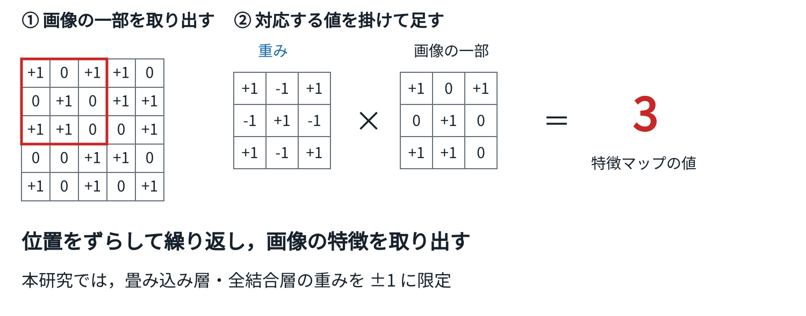
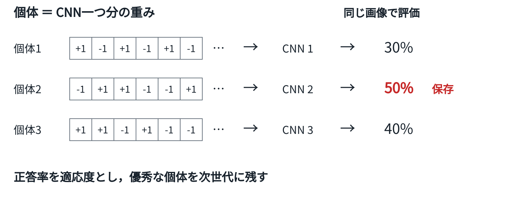
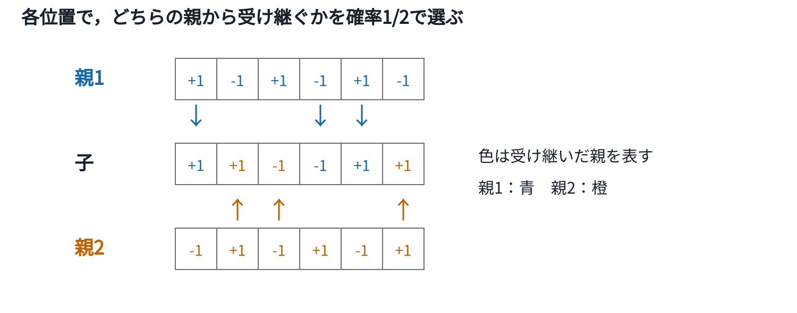
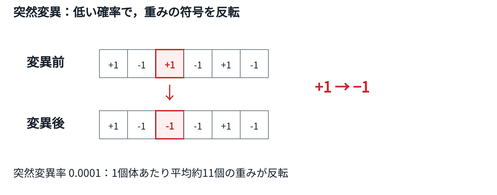
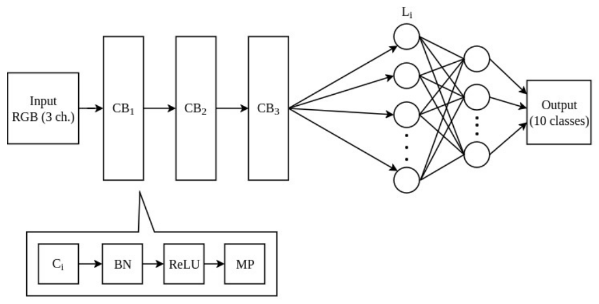
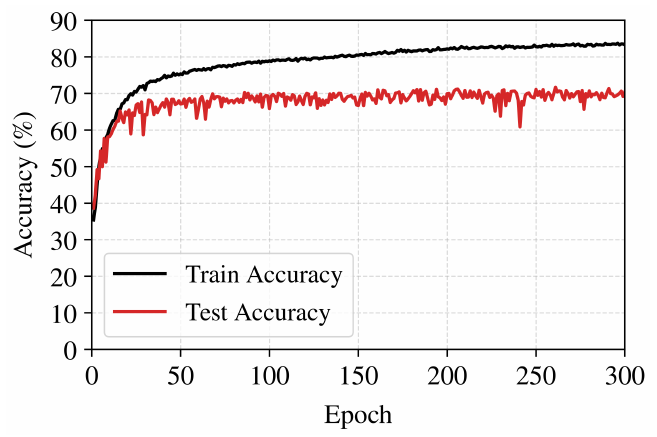
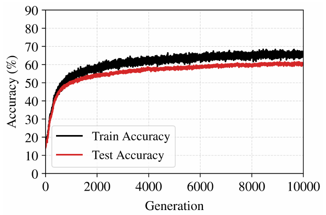
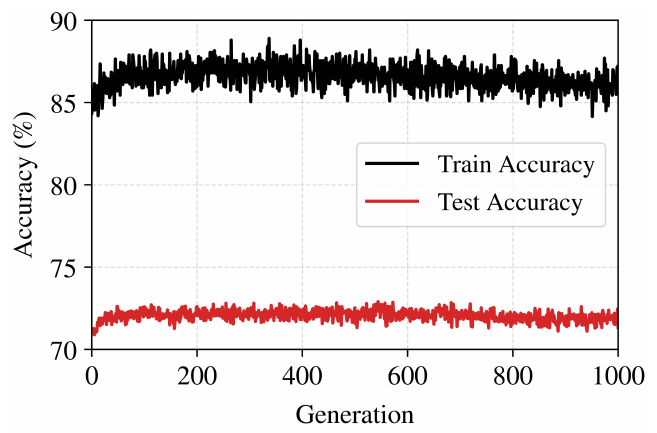

<!-- _class: title -->
# 遺伝的アルゴリズムを用いた 2値化重みを持つ 畳み込みニューラルネットワークの学習

米子工業高等専門学校  
廣芳大二朗　内田雅人

<!--
目安：20秒（0:00〜0:20）

米子工業高等専門学校の廣芳です．遺伝的アルゴリズムを用いた，2値化重みを持つ畳み込みニューラルネットワークの学習について発表します．本研究では，GA単独での学習と，勾配に基づく学習の後にGAを追加する方法を比較しました．
-->

---

# 畳み込みニューラルネットワーク（CNN）

<!--
目安：70秒（0:20〜1:30）

CNNの計算を，この図で説明します．左が入力画像，中央のプラス1とマイナス1の並びがカーネルと呼ばれる重みです．まず，画像の赤枠の部分とカーネルの対応する値を掛け合わせ，その結果を足します．この例では3となり，特徴マップの一つの値になります．次に赤枠を一つずらし，同じ重みで計算します．これを画像全体で繰り返すことで，重みに応じた特徴を取り出します．CNNは，このような畳み込みを重ね，得られた特徴を全結合層で分類します．ここで重要なのは，どの重みを使うかによって取り出す特徴が変わることです．本研究では，この重みをプラス1とマイナス1に限定し，画像を正しく分類できる組合せを学習します．

重みは，画像ごとに人が指定するのではなく，学習によって決まります．そのため，同じネットワーク構造でも，得られた重みの組合せによって分類性能が変わります．
-->

---

# 研究背景・目的

### CNNの軽量化
重みを **±1** に限定し，保存量と演算を削減

### 2値重みの学習
BinaryConnectは，実数重みを保持して勾配で更新

### 本研究の目的
**GAによる直接探索**と，**BP学習後の追加探索**を検証

<!--
目安：30秒（1:30〜2:00）

そこで，重みをプラス1とマイナス1の2値に限定する方法に着目しました．重みの表現を簡単にすることで，保存量の削減や演算の簡略化が期待できます．一方，2値の符号をそのまま微分して学習することは難しいため，学習方法に工夫が必要です．従来のBinaryConnectは，実数の重みを別に保持して勾配で更新します．本研究では，勾配によらず重みの組合せを直接変えるGAに着目し，GAだけで学習できるか，さらにBPの学習結果を改善できるかを調べます．
-->

---

# BPによる学習：BinaryConnect

### ① 順伝播
実数重みを **±1に2値化**して，分類結果と損失を計算

### ② 逆伝播・更新
近似した勾配で **実数重みを更新**

### ③ 次の計算
更新した実数重みを再び2値化し，①を繰り返す

実数重みに小さな更新を蓄積し，符号の変化につなげる

<!--
目安：50秒（2:00〜2:50）

比較の基準となるBinaryConnectを説明します．学習中は実数の重みを保持し，順伝播で使うときに符号に応じてプラス1かマイナス1にします．この2値重みで画像の分類結果を求め，正解との差から損失を計算します．逆伝播では，2値化の部分を近似して勾配を伝え，保持している実数重みを更新します．次の順伝播では，更新した実数重みを再び2値化します．実数重みを保持することで，符号がすぐ変わらない小さな更新も蓄積できます．以降，この方法による学習をBPと呼びます．

このように，分類の計算には2値重みを使い，更新の蓄積には実数重みを使う，という二つの役割があります．一方，今回のGAは，2値重みの組合せそのものを探索します．
-->

---

# GA：個体の表現と評価

<!-- 図中の正答率は説明用の例 -->

<!--
目安：40秒（2:50〜3:30）

GAでは，CNN一つ分の重みを一列に並べて，一つの個体とします．図の一つ一つのマスが重みで，値はプラス1かマイナス1です．個体ごとに重みの組合せが違うため，同じ画像でも分類結果が変わります．そこで，各個体の重みをCNNに設定し，同じ画像を分類させて正答率を求めます．この正答率を適応度として，良い個体を次世代に保存します．図の数値は説明用の例で，この場合は50パーセントの個体2を残します．次に，親となる個体から，新しい重みの組合せを作ります．
-->

---

# GA：交叉

<!--
目安：40秒（3:30〜4:10）

新しい個体を作る操作の一つが交叉です．今回は一様交叉を使います．図の上と下が親，中央が子です．それぞれの位置で，どちらの親の重みを受け継ぐかを2分の1の確率で選びます．青は親1，橙は親2から受け継いだ重みです．子の色を見ると，どちらの親の値を選んだかが分かります．必ずちょうど半分ずつになるわけではありません．このように親の重みを組み合わせて，新しいCNNの重みを作ります．さらに突然変異を加えます．
-->

---

# GA：突然変異

<!--
目安：50秒（4:10〜5:00）

突然変異は，低い確率で遺伝子の値を変える操作です．今回は2値重みなので，符号を反転させます．例では，3番目の重みだけがプラス1からマイナス1に変わっています．交叉が二つの親の重みを組み合わせる操作であるのに対し，突然変異は値そのものを変える操作です．こうして作った個体を再び画像で評価します．評価，良い個体の保存，交叉，突然変異を世代ごとに繰り返し，正答率の高い組合せを探索します．

本実験の突然変異率は0.0001です．探索対象の113,504個の重みにこの確率を掛けると，一つの個体で平均約11個の重みが反転する計算になります．毎回必ず11個変わるわけではなく，反転する位置と個数は確率で変わります．
-->

---

# 実験方法

同じネットワーク構造で，**3手法**を比較

### BPのみ
BinaryConnectで重みを学習

### GAのみ
ランダムな2値重みから探索

### BP＋GA
BPで学習した重みを出発点に，GAで追加探索

<!--
目安：25秒（5:00〜5:25）

実験では同じネットワークを使い，三つの方法を比較しました．一つ目はBinaryConnectによるBPのみです．二つ目は，ランダムな2値重みからGAだけで学習する方法です．三つ目は，BPで学習した重みを初期解として，GAで追加探索する方法です．GAのみでは2値重みを直接学習できるかを，BPとGAの組合せでは，学習済みの重みからさらに改善できるかを確認します．
-->

---

# ネットワーク構成

畳み込み3層・全結合1層の重みを2値化  
探索対象：**113,504個の2値重み**

<!--
目安：30秒（5:25〜5:55）

ネットワークは，畳み込み3層と全結合1層で構成します．画像の特徴を畳み込みブロックで取り出し，最後に10クラスへ分類します．2値化するのは，畳み込み層と全結合層の重みです．探索対象の重みは合計113,504個あります．各重みが二つの値を取るため，組合せは2の113,504乗通りになります．GAで変更するのはこの重みの組合せで，層数やチャネル数などのネットワーク構造は変えません．
-->

---

# データの分割とモデル選択

CIFAR-10：10クラスの画像分類

### 学習用　45,000枚
BPの重み更新・GAの個体評価に使用

### モデル選択用　5,000枚
正答率が最も高いモデルを採用

### テスト用　10,000枚
採用したモデルの性能を比較

<!-- BPの学習条件：学習率0.001，300エポック -->

<!--
目安：40秒（5:55〜6:35）

データはCIFAR-10を使い，学習45,000枚，選択5,000枚，テスト10,000枚に分けます．学習用はBPの重み更新やGAの個体評価に使います．選択用は，途中で得られたモデルから採用するものを決めるためのデータです．選択用正答率が最も高いモデルを採用し，そのテスト正答率を比較します．テストの推移も表示しますが，モデル選択の基準にはしません．
-->

---

# 学習条件

**BP**：学習率 0.001，300エポック

**GA共通**：500体，上位50体を保存，突然変異率 0.0001

- GAのみ：ランダム500体から **10,000世代**
- BP＋GA：BP重み1体＋変異449体＋ランダム50体から **1,000世代**

### GAの適応度は正答率
世代ごとに学習用から **2,000枚** を抽出  
同じ世代の全個体を，同じ画像で評価

<!--
目安：35秒（6:35〜7:10）

BPは学習率0.001で300エポック学習しました．GAは両条件とも500体で，上位50体を保存し，突然変異率を0.0001としました．GAのみはランダムな500体から10,000世代探索します．BPとGAの組合せでは，学習済み重みとその変異個体を中心に初期集団を作り，1,000世代探索します．個体評価には世代ごとに学習用から抽出した2,000枚を使い，同じ世代では全個体を同じ画像で評価します．この2,000枚は個体評価用で，先ほどの5,000枚はモデル選択用です．
-->

---

# 実験結果

| 手法 | テスト正答率 |
| :--- | ---: |
| BPのみ | 71.14% |
| GAのみ | 60.20% |
| **BP＋GA** | **72.41%** |

**BP＋GAは，BPのみより1.27ポイント高い**

単一試行の結果であり，再現性は今後検証する

<!--
目安：40秒（7:10〜7:50）

各手法で選択したモデルのテスト正答率を示します．BPのみは71.14パーセント，GAのみは60.20パーセントでした．GAだけでも画像分類を学習できましたが，今回の条件ではBPには及びませんでした．BPの後にGAを加えると72.41パーセントとなり，BPのみより1.27ポイント高くなりました．ただし，これは単一試行の結果です．改善が安定して得られるかについては，複数回の実験が必要です．

GAのみとBPにGAを追加する方法では，出発点が異なります．今回の結果からは，ランダムな重みからGAだけで学習する場合より，BPで得た解を改善する用途に可能性が見られます．
-->

---

# 学習の推移：BP

学習用は約83%まで上昇，テストは約70%で停滞

<!--
目安：30秒（7:50〜8:20）

ここから学習の推移を見ます．まずBPです．横軸はエポック数，縦軸は正答率です．黒線の学習データの正答率は，およそ83パーセントまで上がります．一方，赤線のテスト正答率は70パーセント前後で停滞し，両者に差が生じています．学習データに対する改善が，そのまま未知の画像に対する改善にはつながっていないことが分かります．この学習済みの重みを，追加GAの出発点として使います．
-->

---

# 学習の推移：GAのみ

学習用・テストとも緩やかに上昇（約66%，約60%）

<!--
目安：30秒（8:20〜8:50）

次にGAのみです．横軸は世代数です．黒線と赤線はどちらも緩やかに上昇し，学習用の評価画像では約66パーセント，テストでは約60パーセントに到達しています．黒線は世代ごとに抽出した画像での評価なので，BPの学習曲線と完全に同じ条件ではありません．探索する重みの組合せは非常に多く，今回の世代数では探索が十分でなかった可能性があります．ただし，曲線だけから原因を一つに特定することはできません．
-->

---

# 学習の推移：BP＋GA

序盤にテスト正答率が向上し，その後は停滞・緩やかに低下

<!--
目安：45秒（8:50〜9:35）

BPの後にGAを追加した結果です．序盤にはテスト正答率が向上しましたが，その後は停滞し，緩やかな低下も見られます．一方，学習用の適応度は高くなっており，適応度の改善とテスト性能の改善が一致していません．考えられる要因の一つは，世代ごとに評価する2,000枚の違いです．その画像に対して偶然高い正答率を得た個体が残る可能性があります．また，学習画像への適応が進むことも考えられます．いずれも現時点では仮説であり，有効な組合せを探索し尽くしたとまでは言えません．
-->

---

# 考察

### BP＋GAの改善
学習済み重みにも，GAで改善できる組合せがあった

### 後半の停滞・低下
評価する2,000枚の違いや，学習画像への適応が影響した可能性

### 今後確かめること
複数試行での再現性と，追加計算時間に対する改善幅

局所解からの脱出や，低下の原因は未確認

<!--
目安：45秒（9:35〜10:20）

結果の解釈を整理します．今回の実験では，BPで得た重みを出発点にしても，GAによって改善する余地が見られました．ただし，この改善だけで，局所解から脱出したとは判断できません．また，一回の試行であるため，統計的に有意な改善かどうかも未確認です．乱数シードを変えた試行や，学習時間を含めた比較によって，追加GAの有効性を確かめる必要があります．

追加GAには計算時間も必要なので，正答率の改善幅に対して，どれだけの計算が必要かも重要です．今後は，BPを追加で学習する場合との比較など，追加計算の使い方として有効かどうかも検討します．
-->

---

# まとめ

### GAのみ
2値重みCNNを学習できたが，BPのみには及ばなかった

### BP＋GA
今回の試行では，BPのみから **1.27ポイント改善**

### 今後の課題
- 乱数シードを変えて再現性を検証
- 評価枚数・交叉方法・個体群の多様性を検討

<!--
目安：40秒（10:20〜11:00）

まとめです．GAのみでも2値重みCNNを学習でき，テスト正答率60.20パーセントを得ましたが，BPのみには及びませんでした．一方，BPの後にGAを追加すると72.41パーセントとなり，今回の試行では1.27ポイントの改善が得られました．今後はまず複数試行で再現性を確認します．あわせて，評価に使う画像枚数や交叉方法，個体群の多様性を検討し，より安定して改善できる条件を調べます．以上で発表を終わります．
-->
